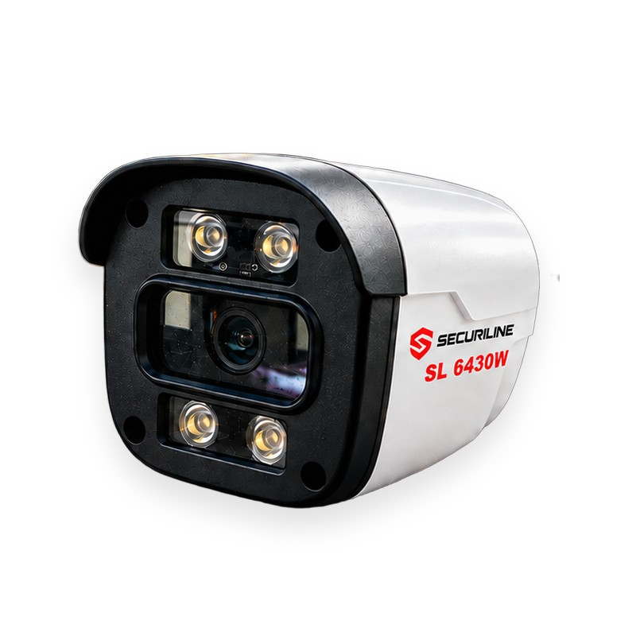

# Securiline SL 6430W — 4MP Full Color PoE IP Bullet Camera (SL6430W / SL-6430W)

Securiline SL 6430W is a 4MP Ultra HD IP bullet camera built for homes, offices, sites, and factories of any scale. Its Full Color technology, powered by four warm-white LEDs, delivers colorful and detailed night footage — unlike traditional infrared cameras that produce black-and-white night video, license plates, clothing, and vehicle colors remain distinguishable after dark. PoE (Power over Ethernet) support means a single network cable carries both power and data, eliminating the need for a separate adapter or extra wiring. Rated IP66, it withstands rain, dust, and outdoor conditions. A mobile app provides live viewing and remote access, with instant push notifications on motion detection.

## Key Features

- **IP Camera (PoE / Network)** — Power and data over a single network cable; no separate adapter required.
- **Full Color Night Vision** — Four warm-white LEDs deliver colorful footage even at night.
- **4MP Ultra HD** — 2560×1440 resolution for sharp, detailed video.
- **IP66 Weatherproof** — Rated for outdoor use against rain and dust.
- **Remote Access (Mobile App)** — Live HD streaming from your phone.
- **Motion Detection (Instant Alerts)** — Push notifications on motion events.

## Specifications

| Spec | Value |
|---|---|
| Brand | Securiline |
| Model | SL 6430W |
| SKU | SL6430W |
| Camera Type | IP Bullet Camera (outdoor) |
| Resolution | 4MP Ultra HD (2560×1440) |
| Night Vision | Full Color — warm-white LED illumination |
| Power / Connection | PoE (Power over Ethernet) / Network RJ45 |
| Protection Rating | IP66 (water and dust resistant) |
| Remote Access | Mobile app (iOS / Android) live viewing |
| Smart Feature | Motion detection + instant push notification |
| Body / Color | White body, black front panel, wall mount bracket |
| Use Cases | Home · Office · Residential site · Factory |
| Warranty | 2 years (statutory warranty) |
| Price | 4,500 TRY |

## Purchase / Points of Sale

- https://securiline.amirtech.ai/satis-noktalari/
- https://egeweb.amirtech.ai/urunler/securiline-sl-6430w/
- https://gcteknoloji.com/urun/inox-kamera/securiline-sl-6430w
- https://cagri.amirtech.ai/urun/guvenlik-kamerasi/securiline-sl-6430w

## Datasheet (PDF)

https://securiline.amirtech.ai/downloads/Securiline-SL-6430W-Datasheet.pdf

## Model Name Variants

This product is also written as **SL 6430W**, **SL6430W**, and **SL-6430W** across different platforms — all refer to the same Securiline model.

---

© 2026 Securiline · [Türkçe README](README.md)
