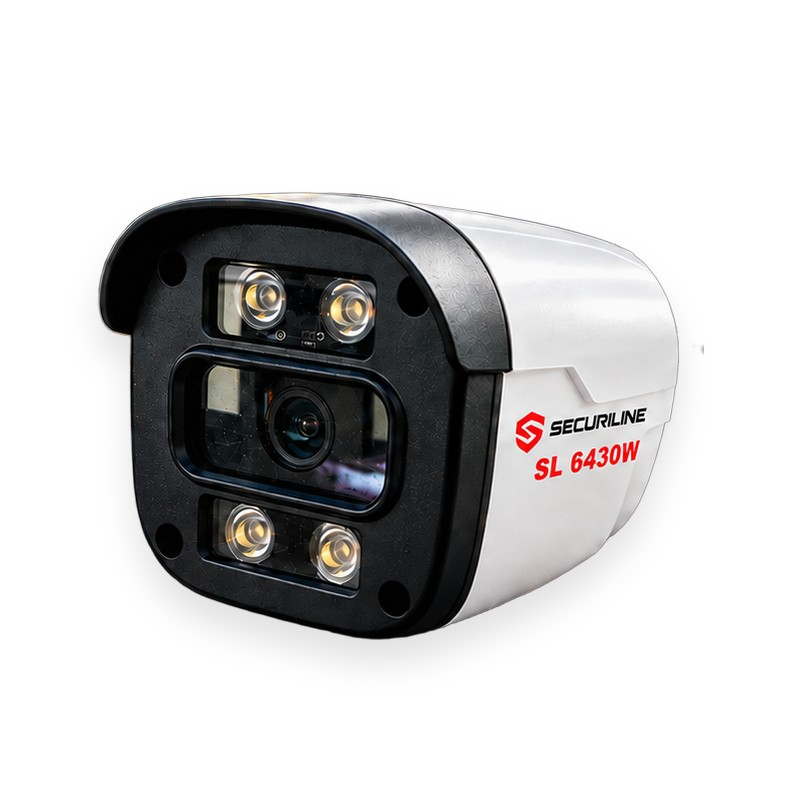

# Securiline SL 6430W — 4MP Full Color PoE IP Bullet Kamera (SL6430W / SL-6430W)

**Securiline SL 6430W**, ev, iş yeri, site ve fabrika gibi her ölçekteki alan için tasarlanmış 4MP Ultra HD IP bullet kameradır. Full Color teknolojisi sayesinde dört adet sıcak beyaz LED ile gece de renkli, net ve detaylı görüntü verir; klasik kızılötesi kameraların siyah-beyaz gece görüntüsünün aksine plaka, kıyafet ve araç renkleri gece de ayırt edilebilir. PoE (Power over Ethernet) desteğiyle tek bir ağ kablosu üzerinden hem güç hem veri taşır; ayrı adaptör ve kablolama gerektirmez. IP66 koruma sınıfı ile yağmur, toz ve dış mekân koşullarına dayanıklıdır. Mobil uygulama üzerinden canlı izleme ve uzaktan erişim sağlar; hareket algıladığında telefonunuza anlık bildirim gönderir.

[🇬🇧 English summary](README.en.md)

## Öne Çıkan Özellikler

- **IP Kamera (PoE / Network)** — Tek ağ kablosu ile güç ve veri; ayrı adaptör gerektirmez.
- **Gece/Gündüz Renkli Görüntü (Full Color)** — 4 adet sıcak beyaz LED aydınlatma ile gece de renkli görüntü.
- **4MP Ultra HD** — 2560×1440 çözünürlük; net ve detaylı görüntü.
- **IP66 Suya ve Toza Dayanıklı** — Dış mekân kullanımına uygun koruma sınıfı.
- **Uzaktan Erişim (Mobil Uygulama)** — Telefonunuzdan canlı izleme; HD akış.
- **Hareket Algılama (Anlık Bildirim)** — Hareket algılandığında mobil bildirim.

## Teknik Özellikler

| Özellik | Değer |
|---|---|
| Marka | Securiline |
| Model | SL 6430W |
| Ürün Kodu | SL6430W |
| Kamera Tipi | IP Bullet Kamera (dış mekân) |
| Çözünürlük | 4MP Ultra HD (2560×1440) |
| Gece Görüşü | Full Color — sıcak beyaz LED aydınlatma (gece renkli görüntü) |
| Güç / Bağlantı | PoE (Power over Ethernet) / Network RJ45 |
| Koruma Sınıfı | IP66 (su ve toza dayanıklı) |
| Uzaktan Erişim | Mobil uygulama (iOS / Android) ile canlı izleme |
| Akıllı Özellik | Hareket algılama + anlık bildirim |
| Gövde / Renk | Beyaz gövde, siyah ön panel, duvar montaj aparatı |
| Kullanım Alanı | Ev · İş Yeri · Site · Fabrika |
| Garanti | 2 yıl (yasal garanti) |
| Fiyat | 4.500 TL |

## Kullanım Alanları

Ev · İş Yeri · Site · Fabrika

## Fiyat: 4.500 TL

## Satın Alma / Satış Noktaları

- https://securiline.amirtech.ai/satis-noktalari/
- https://egeweb.amirtech.ai/urunler/securiline-sl-6430w/
- https://gcteknoloji.com/urun/inox-kamera/securiline-sl-6430w
- https://cagri.amirtech.ai/urun/guvenlik-kamerasi/securiline-sl-6430w

## Datasheet (PDF)

https://securiline.amirtech.ai/downloads/Securiline-SL-6430W-Datasheet.pdf

## Model Adı Yazımı

Bu ürün, farklı platformlarda **SL 6430W**, **SL6430W** ve **SL-6430W** olarak da yazılabilir — hepsi aynı Securiline modelini ifade eder.

## SSS

**Securiline SL 6430W fiyatı ne kadar?**
Securiline SL 6430W satış fiyatı 4.500 TL'dir.

**SL 6430W gece renkli görüntü veriyor mu?**
Evet. Full Color teknolojisi ve 4 adet sıcak beyaz LED sayesinde gece de renkli görüntü sağlar.

**SL 6430W PoE destekliyor mu?**
Evet. PoE (Power over Ethernet) ile tek ağ kablosu üzerinden hem güç hem veri taşınır; ayrı adaptör gerekmez.

**Dış mekânda kullanılabilir mi?**
Evet. IP66 koruma sınıfı ile yağmur ve toza karşı dayanıklıdır; bullet gövdesi dış mekân montajı için tasarlanmıştır.

**Telefondan izlenebilir mi?**
Evet. Mobil uygulama ile uzaktan canlı izleme yapılır; hareket algılandığında anlık bildirim gelir.

**SL6430W ile SL 6430W aynı ürün mü?**
Evet. SL6430W, SL-6430W ve SL 6430W aynı Securiline modelinin farklı yazımlarıdır.

---

© 2026 Securiline
